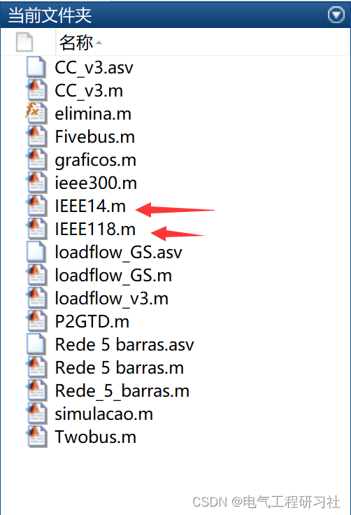

# Power System Flow Analysis (Matlab Code Implementation)

​  
📋📋📋This article is organized as follows: ⛳️⛳️⛳️​Directory 1 Voltage and phase angle in power systems 2 Linearized power flow, or DC power flow 3 State estimation 4 Matlab code and detailed articles 5 Final thoughts 1 Voltage and phase angle have been crucial to our society for decades. From simple requirements, such as public lighting, to more complex ones, such as medical equipment and the entire industry, we have electricity only. Moreover, the electricity is very stable. For this, some methods are needed to provide us with the current state of our system so that we can take appropriate action. In this work, we will study power flow, which is a method that provides us with node voltage and phase angle.
2. Linearization of the power flow, or DC power flow Here, the power system analysis tool discussed will be a power flow analysis. This analysis will provide us with a method to calculate the important quantities of the entire system, starting from some known quantities, which are measurable. This is an application for static systems.
3 State Estimation
4. Matlab code and detailed article: This article only showcases a portion of the code, the complete code can be found in:
Editor
Editor
5. End Note: The references to theoretical concepts are from online literature sources, and if any infringement is found, please contact the blogger for removal.
​  

## Images

<!-- PAYMENT_BLOCK -->

## Get this dataset

- Payment link (Stripe): [Buy now](https://buy.stripe.com/3cs8yP7sY87d0vu9AB)
- Payment QR code: 

<!-- /PAYMENT_BLOCK -->
